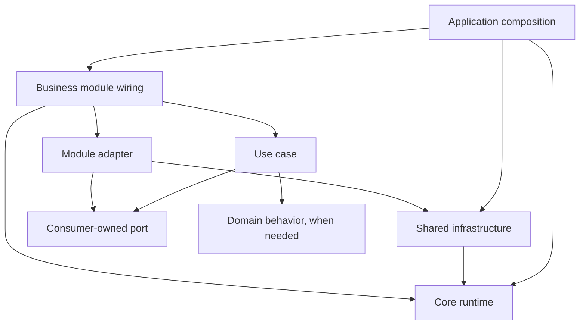

# Web Service Template

[](https://www.prisma.io/)

A modular backend application foundation with hexagonal-inspired business module conventions. Fastify serves HTTP, Awilix assembles the application and Prisma connects to PostgreSQL. For maintainers and coding agents, the engineering and review rules live in [AGENTS.md](AGENTS.md).

## 📋 Table of Contents

- [📝 Project Introduction](#-project-introduction)
- [🚀 Quick Start](#-quick-start)
- [📂 Project Structure](#-project-structure)
- [🏗 System Architecture](#-system-architecture)
- [💻 Development Guide](#-development-guide)
- [🗄 Database (Prisma 7)](#-database-prisma-7)
- [⚙️ Environment Variables](#-environment-variables)
- [🔧 Module Setup Example](#-module-setup-example)
- [📦 Deployment](#-deployment)
- [❓ FAQ](#-faq)

## 📝 Project Introduction

A fresh checkout starts a web server with a welcome page and an empty business-module registry. Add a business capability by declaring its dependencies in a module and including that module in the application. The [catalog example](#-module-setup-example) shows a complete request and the decision about whether an entry is visible.

## 🚀 Quick Start

Run the following commands from the repository root. Use the Node.js major in [.nvmrc](.nvmrc) and the pnpm version selected by [CI](.github/workflows/ci.yaml). If you use nvm, `nvm use` selects the project Node version.

1. In a fresh checkout, copy the local settings.

   ```bash
   cp .env.example .env
   ```

2. Set `DATABASE_URL` in your `.env` to a running local PostgreSQL database and confirm it accepts connections.

   The [development Compose file](.dev-app-projects/docker-compose.yaml) pairs `postgres:latest` with the data mount used by PostgreSQL 17 and earlier (`/var/lib/postgresql/data`). For a fresh database using the official PostgreSQL 18 or later image, mount a new data directory at `/var/lib/postgresql` in your local Compose configuration. See the [official image's volume guidance](https://github.com/docker-library/docs/blob/master/postgres/README.md#pgdata).

3. Install dependencies, generate the Prisma client and build before starting the watchers.

   ```bash
   pnpm run install:ci
   pnpm run build
   pnpm start
   ```

   The build generates Prisma Client before compiling TypeScript. Run it once to give the server watcher its `build/index.js` entry point.

4. With the example settings, open `http://localhost:3000/` for the welcome page and `http://localhost:3000/docs` for Swagger UI. The UI is enabled in non-production environments.

## 📂 Project Structure

### Current checkout

The application builds as a single package. The following paths exist in the repository.

| Path | Responsibility |
| --- | --- |
| [index.ts](index.ts) | Composition root. Passes the global registrations and business modules to `setupApp`, registers the HTTP startup module and sequences startup and shutdown. |
| [src/modules/index.ts](src/modules/index.ts) | Exports the list of business module instances. It starts as an empty array. |
| [src/core/app](src/core/app) and [src/core/di](src/core/di) | Application lifecycle, container creation and dependency registration. |
| [src/core/server](src/core/server) | Fastify setup, route registration, HTTP errors and Swagger. |
| [src/core/config](src/core/config) and [src/core/services](src/core/services) | Environment loading and transformation, logging, and the current concrete Prisma configuration and client. |
| [src/core/types](src/core/types) and [src/core/utils](src/core/utils) | Module and startup contracts, registration helpers and initializer pool. |
| [prisma](prisma) | PostgreSQL schema, migrations and seed source. |
| [test-utils](test-utils) | Test containers, mocks and compile-time contract checks. |

TypeScript resolves `src/*` from the root and emits the application under `build/`. The [global DI registrations](src/core/di/global-di-configs.ts) currently select Prisma in Core.

### Target structure

The workspace design gives Core, each shared resource and each business module a package boundary. For example, the shared database client would live under `src/infrastructure/prisma/`. Module-local persistence code would stay beside the business capability that defines its port. In the workspace design, a module's implementation sits under its package's own `src/` and consumers use package exports. The workspace conversion, package build output and deployment work are tracked in the [workspace specification](https://github.com/RougeLi/WebServiceTemplate/issues/33).

## 🏗 System Architecture

This diagram shows the **target source dependencies**. Each arrow points from an importer to a dependency.



At runtime an HTTP request reaches the route, the controller converts the input and the use case calls the injected adapter through its port. An adapter backed by a database then calls the shared client. A compiled TypeScript interface adds no runtime call. A use case that only computes a result can call a pure domain function directly.

For new or explicitly refactored business flows, the source dependency is `Use Case → Port ← Adapter`. Use cases and domain code stay independent of concrete adapters, ORM types and HTTP transport types.

The stock application supports one active application per Node process. Its entry point explicitly registers `WebServerModule`. A business `IModule` declares dependencies, while an `IStartupModule` owns initialization, start and stop work. The required Prisma hook waits for a successful `SELECT 1` before HTTP listen. Fastify close triggers the singleton disposer, including when startup fails after the HTTP module has initialized. The precise boot order, initializer pool and non-HTTP cleanup limits are documented in the [startup module guide](src/core/types/README.md).

## 💻 Development Guide

Run scripts from the repository root. Their definitions are in [package.json](package.json).

| Command | Purpose |
| --- | --- |
| `pnpm run install:ci` / `pnpm run install:dev` | Install with a frozen lockfile, or allow lockfile updates during development. |
| `pnpm run prisma:generate` | Generate the client used by the TypeScript sources. |
| `pnpm run build` / `pnpm start` | Build once, or run the TypeScript and server watchers after the initial build. |
| `pnpm run lint` | Run source and spec type checks, Prettier checks and ESLint. |
| `pnpm run lint:fix` | Apply the configured formatting and ESLint fixes. |
| `pnpm run unittest` / `pnpm run unittest:coverage` | Run Jest with or without coverage reporting. |
| `pnpm run prisma:migrate` | Create and apply a development migration against the configured database. |
| `pnpm run prisma:reset` | Reset a disposable development database and reapply its migrations. This discards its data. |

## 🗄 Database (Prisma 7)

### Versions and upgrades

`prisma` (devDependency), `@prisma/client` and `@prisma/adapter-pg`
(dependencies) are pinned to the same exact version, **7.10.1**. Upgrade the
three packages together, by hand: read the Prisma release notes, check the
Node.js engine, TypeScript and pnpm requirements, then rerun

```bash
pnpm run install:ci && pnpm run prisma:generate && pnpm run type:check \
  && pnpm run type:check:spec && pnpm run lint && pnpm run unittest \
  && pnpm run build
```

plus a check against a disposable PostgreSQL database (migrations, seed,
queries, application start and stop).
`pnpm-workspace.yaml` lists them under `updateConfig.ignoreDependencies`, so
`pnpm run update:dependencies` (`pnpm update --latest`) leaves them alone;
without it, `prisma` would move to the `latest` dist-tag (an 8.x release
candidate at the time of writing) while the other two stay on 7.x.

The pg pool is created by `@prisma/adapter-pg`; the project does not import
`pg` directly and does not declare `pg` / `@types/pg`. If code ever needs
`pg` directly, add it as a runtime dependency (and `@types/pg` as a
devDependency) instead of relying on the transitive copy.

### CLI configuration vs. runtime configuration

| | Prisma CLI | Application runtime |
| --- | --- | --- |
| Entry | `prisma.config.ts` (repository root) | `src/core/services/prisma.config.ts` + `prisma.service.ts` |
| Loads `.env` | `dotenv/config` (variables already in the environment win) | `loadEnvironment()` in `setupApp` |
| Database URL | `process.env.DATABASE_URL`, trimmed; `datasource` is omitted when empty | `DATABASE_URL`, validated before the adapter is created |
| Used for | `generate`, `migrate *`, `db seed` | Shared `PrismaService` (`ContainerTokens.PRISMA`) |

The application never imports `prisma.config.ts`, and the CLI config never
loads the application, DI or logger. Without `DATABASE_URL`,
`prisma generate` still works; `migrate dev`, `migrate deploy`,
`migrate status` and `migrate reset` stop with
`The datasource.url property is required in your Prisma config file` and exit 1.
`prisma db seed` does not check the URL itself, so `prisma/seed.ts` validates
`DATABASE_URL` first and exits non-zero without printing
`Seeding completed.` when it is missing or invalid.

### Explicit operation order

Prisma 7 does not chain these steps for you, and nothing runs migrations or
seeds during `generate`, `build` or a normal application start.

```bash
# Local development, after editing prisma/schema.prisma
pnpm run prisma:migrate    # prisma migrate dev: create and apply a migration
pnpm run prisma:generate   # regenerate src/generated/prisma
pnpm run prisma:seed       # optional

# Deployment
pnpm run prisma:deploy     # prisma migrate deploy (needs the Prisma CLI, i.e. a full install)
NODE_PATH=./build node build/index.js

# Resetting a disposable development database (never production)
pnpm run prisma:reset      # prisma migrate reset
pnpm run prisma:generate
pnpm run prisma:seed
```

Migrations and seeds must target a database you chose explicitly; there is no
fallback to a local default database.

### Seed

`prisma.config.ts` runs `ts-node prisma/seed.ts` as the seed command. The seed
currently only validates `DATABASE_URL`; the template ships no seed data. If a
seed needs the Client:

1. run `pnpm run prisma:generate` first;
2. import it with a relative path, `import { PrismaClient } from '../src/generated/prisma/client'`
   (the `src/*` alias would require `NODE_PATH=.` in the seed command);
3. create the Client with a `PrismaPg` adapter and call `$disconnect()` in a
   `finally` block, returning a non-zero exit code on failure. The seed's
   Client is independent of the application's shared instance.

### Generated Client and imports

`prisma/schema.prisma` uses the `prisma-client` generator with
`moduleFormat = "cjs"`, so the project stays CommonJS with NodeNext module
resolution. The Client is generated as TypeScript into
`src/generated/prisma/` (ignored by Git, Prettier, ESLint and coverage) and
compiled with the rest of `src/` by `pnpm run build`.

| Context | Import | Resolves to |
| --- | --- | --- |
| Source type-check (`tsc`) and Jest | `src/generated/prisma/client` | `src/generated/prisma/client.ts` |
| `ts-node` scripts and the seed | `../src/generated/prisma/client` (relative), or the alias with `NODE_PATH=.` | `src/generated/prisma/client.ts` |
| Compiled (`NODE_PATH=./build`) | `src/generated/prisma/client` | `build/src/generated/prisma/client.js` |

`ts-node` does not apply the `tsconfig.json` `paths` at run time, so a bare
`src/...` import fails there unless `NODE_PATH=.` is set.

Regenerate after every schema change (`pnpm run prisma:generate`). `pnpm start`
runs `prisma:generate` before starting the TypeScript and nodemon watchers, but
the watchers do not regenerate the Client when `prisma/schema.prisma` changes.

The compiled build runs with production dependencies only
(`pnpm install --prod --frozen-lockfile` plus `build/`): the Prisma CLI,
`ts-node` and `src/` are not needed at runtime.

### Runtime connection

`PrismaService` still extends the generated `PrismaClient` and is registered as
a singleton under `ContainerTokens.PRISMA`. When it is resolved,
`PrismaConfig.getDatabaseConnectionOptions()` validates `DATABASE_URL` and
builds a `PrismaPg` adapter:

- `DATABASE_URL` must be non-empty after trimming, parse as a URL, use the
  `postgresql:` or `postgres:` scheme and include a hostname or a nonempty effective `host` parameter.
  pg uses the last value of repeated parameters. An invalid target raises a `DatabaseConfigurationError` whose
  message never contains the URL or the path. pg itself would silently fall
  back to `localhost:5432` for an empty URL, and would parse a value such as
  `not-a-url` relative to a dummy URL and connect to an unintended host.
- A Unix-socket URL with credentials needs a placeholder host, for example
  `postgresql://<user>:<password>@localhost/<database>?host=/var/run/postgresql`;
  the form with an empty host (`@/`) is not a valid URL.
- Validation happens on resolve, not on import, registration or
  `EnvironmentService` construction, so unit tests and builds do not need
  `DATABASE_URL`.
- At `connect()`, the service checks that any `sslrootcert`, `sslcert` or `sslkey` refers to a readable file before attempting the readiness query. When a TLS client key or certificate is supplied, Node validates the local PEM material before the driver opens a socket. Creating the Client opens no connection and reads no certificate files.

| Setting | Prisma 6 | Prisma 7 + `PrismaPg` (this template) |
| --- | --- | --- |
| Pool size | CPU count × 2 + 1, `connection_limit` URL parameter | `DATABASE_POOL_MAX`, default `10` |
| Connect / pool wait timeout | `connect_timeout` (5 s) and `pool_timeout` (10 s) | `DATABASE_CONNECTION_TIMEOUT_MS`, default `10000`, covers both |
| Timeout error | `P2024` | Plain `Error`: `Connection terminated due to connection timeout` or `timeout exceeded when trying to connect` |
| Idle connections | engine default | pg default, closed after 10 s idle |
| `?schema=` | applied by the engine to every query (`SET search_path`) | parsed by the template and passed as `PrismaPg`'s `schema` option: model queries only; raw SQL keeps the connection `search_path` |
| TLS without SSL parameters | `sslmode=prefer` (TLS when the server offers it) | no TLS unless an SSL setting such as `sslmode`, `ssl`, a certificate parameter or `PGSSLMODE` is present |
| Interactive transactions | `maxWait` 2000 ms, `timeout` 5000 ms | unchanged (`P2028` when exceeded) |

pg's own connection timeout default is `0` (wait forever), which would block
both the retry loop and shutdown on an unroutable host; the template therefore
always sets a finite timeout.

Prisma 6-only URL parameters (`connection_limit`, `pool_timeout`,
`connect_timeout`, `socket_timeout`, `pgbouncer`, `statement_cache_size`,
`channel_binding`, `sslaccept`, `sslidentity`, `sslpassword`) are not applied
by pg. When present, `PrismaService` logs a warning that lists only their
names. Parameters pg understands (for example `sslmode`, `sslrootcert`,
`application_name`, `options`) are applied.

`?schema=` is honoured by the CLI and by model queries, so migrations and the
Client's model API target the same PostgreSQL schema. Raw SQL (`$queryRaw`,
`$executeRaw`) is different from Prisma 6: it runs with the connection's
`search_path`, so unqualified table names resolve in `public` (or the role's
default). When `?schema=` is set, `PrismaService` logs a warning unless the
URL's `options` parameter sets a search path that starts with that schema.
The schema parameter preserves the identifier's case and whitespace. An explicit empty schema is invalid. When migrating SQL that used Prisma 6's URL schema, qualify the table explicitly.
For a database URL with `?schema=tenant`, rewrite the query as follows.

```sql
-- Prisma 6
SELECT * FROM "Log";
-- Prisma 7
SELECT * FROM tenant."Log";
```

The template leaves the PostgreSQL search path and startup options under the connection owner's control.

`sslmode` is applied by pg: `sslmode=require` against a server without TLS
fails with `TlsConnectionError`. pg currently treats `prefer`, `require` and
`verify-ca` as `verify-full` and prints a security warning that pg 9 will
switch to libpq semantics; use `sslmode=verify-full` to keep today's behaviour
explicitly. With `uselibpqcompat=true`, `sslmode=verify-ca` requires a readable `sslrootcert`. Without any SSL setting (for example `sslmode`, `ssl`,
`sslnegotiation=direct`, a certificate parameter or the `PGSSLMODE`
environment variable) pg does not use TLS, whereas Prisma 6 defaulted to
`prefer`; set `sslmode` (with `sslrootcert` for a private CA) when the server
requires TLS. A certificate parameter without `sslmode` turns on TLS with
certificate verification, while `sslmode=disable` still disables TLS and
`sslmode=no-verify` disables verification. Certificate parameters also
changed meaning:
Prisma 6's `sslcert` was the server (CA) certificate, while pg reads `sslcert`
as the client certificate and `sslrootcert` as the CA, and pg resolves the
paths relative to the working directory instead of `./prisma`. Never disable
certificate verification globally to make a connection work.

### Readiness, retries and errors

`connect()` (run by the Prisma `onInitiate` hook) calls `$connect()` and then
`SELECT 1` through `$queryRaw`. With driver adapters `$connect()` does not open
a connection, so only a successful query counts as ready, and
`Database connection established.` is logged only after it. Failures are
classified by `error.meta.driverAdapterError.cause.kind`, not by Prisma error
codes or message text (`$queryRaw` reports connection failures as `P2010`;
model queries as `P1000`, `P1001`, `P1003`).

| Classification | Errors |
| --- | --- |
| Fail fast (no retry) | `AuthenticationFailed`, `DatabaseDoesNotExist`, `DatabaseAccessDenied`, `TlsConnectionError`, `DatabaseConfigurationError`, a revoked `CONNECT` privilege (kind `postgres`, SQLSTATE `42501`), local OpenSSL key decoding or certificate/key mismatch errors, a missing password (pg: `client password must be a string`) |
| Retry | `DatabaseNotReachable`, `SocketTimeout`, `ConnectionClosed`, `TooManyConnections`, errors without a `kind` (such as the pg connection timeout), and any other `kind` |

Retries keep the previous semantics: unlimited attempts, waiting
`1000 ms × attempt` plus 0–500 ms jitter, capped at 30 s, with each attempt
bounded by `DATABASE_CONNECTION_TIMEOUT_MS`. Log messages contain the
classification and the driver message (host, port or user name), never the
connection string or password.

### Startup and shutdown

| Situation | Behaviour |
| --- | --- |
| Import, `prisma generate`, `build` | No database connection |
| Normal `initialize()` | Startup modules initialize, then the global `onInitiate` hooks run; the Prisma hook succeeds only after `SELECT 1`, and only then does `start()` begin accepting HTTP requests |
| Fail-fast error (missing/invalid `DATABASE_URL`, bad credentials, missing database, access denied, TLS or certificate error) | `initialize()` rejects, HTTP never starts, `index.ts` cleans up and exits with code 1 |
| Database temporarily unavailable | The Prisma hook keeps retrying with backoff; HTTP starts once the database answers |
| `app.stop()` / Fastify close (also on SIGINT/SIGTERM through `close-with-grace`) | The container is disposed and the Prisma Client and its pool are released once |
| A request completes | The request scope is disposed; the application singleton stays open |
| `initialize()` or `start()` fails | `index.ts` logs the original error, calls `app.stop()` to release what was created, logs any cleanup error separately, and exits with code 1 |

Two opt-in fields of `GlobalContainerConfig` implement this:

- `required: true` makes an `onInitiate` failure reject `Application.initialize()`.
  All hooks still run concurrently, the rejection happens only after every
  hook has settled, and if several required hooks fail the first original
  error (in the order the failures occur) is rethrown. Hooks without the flag
  keep the previous contract: the failure is logged and initialization
  continues. Only the Prisma hook is marked required.
- `onDispose(instance)` becomes the registration's Awilix `.disposer()` and
  runs only for instances that were resolved. A singleton is released when the
  root container is disposed (Fastify close with `disposeOnClose`); a scoped
  instance is released when the scope that resolved it is disposed (per request
  with `disposeOnResponse`); transient instances are never disposed. Request
  scope disposal does not touch root singletons, and an instance that was
  never resolved is never created or disposed. The Prisma registration's disposer calls
  `PrismaService.disconnect()` and is the only owner of the shared Client and
  pool; `Application.stop()` does not dispose the container itself.

Known limitations (general application lifecycle work is tracked in [#32](https://github.com/RougeLi/WebServiceTemplate/issues/32)):

- An application without `WebServerModule` has no trigger that disposes the
  container, so the Prisma pool is not released by `app.stop()`.
- A query after `$disconnect()` silently creates a new pool, and resolving
  `ContainerTokens.PRISMA` after the container was disposed creates a new
  Client.
- One process runs one active application; restarting an application in the
  same process is not supported.

### Connection ownership

- Each application has one shared Client and pool (`ContainerTokens.PRISMA`,
  singleton). Request scopes resolve the same instance; nothing is created per
  request.
- The registration's disposer releases the Client and pool when the
  container is disposed. `$disconnect()` closes the adapter's pool, and calling
  it twice is safe.
- CLI commands, seeds and scripts create their own Client and must
  `$disconnect()` it in `finally`; they never take over the application's
  instance.
- Tests can register a fake under `ContainerTokens.PRISMA` in an isolated
  container; no database is needed.

### Query logging

Logging options are unchanged: query events in development or with
`FORCE_PRISMA_QUERY_LOG=true` (`debug` normally, `info` when forced), `info` /
`warn` / `error` events routed to the matching logger level, parameter
formatting with `PRISMA_QUERY_ENABLE_JSON_PARSE`, `PRISMA_QUERY_DELIMITER` and
truncation, and `errorFormat` (`pretty` in development, `minimal` elsewhere).
With Prisma 7.10.1 and `PrismaPg`:

- `query` events keep `timestamp`, `query`, `params` (JSON string), `duration`
  and `target` (`ClientEngine`). `duration` is now fractional; the formatter
  rounds it to whole milliseconds as before.
- Transaction control statements (`BEGIN`, `COMMIT`, `ROLLBACK`) appear as
  query events.
- `error` events are emitted for failed queries. No `info` or `warn` events
  were observed; the subscriptions are kept.

### Consumer migration notes (Prisma 6 → 7)

- Import the Client, the `Prisma` namespace, model types and error classes
  (`Prisma.PrismaClientKnownRequestError`, ...) from
  `src/generated/prisma/client` instead of `@prisma/client` or `.prisma/client`.
  There is no compatibility shim for the old location.
- `PrismaService`, `ContainerTokens.PRISMA`, `ContainerTokens.PRISMA_CONFIG`
  and `IDBService.connect/disconnect` keep their names and injection. New:
  `PrismaConfig.getDatabaseConnectionOptions()`, `databasePoolMax` and
  `databaseConnectionTimeoutMs`. `CustomPrismaClient` now includes `$queryRaw`
  (used for readiness); hand-written fakes typed with it need that member.
- The Prisma Client constructor returns its own object, so
  `instanceof PrismaService` / `instanceof PrismaClient` is `false`, as it
  already was with Prisma 6.
- Replace Prisma 6 URL parameters with `DATABASE_POOL_MAX` and
  `DATABASE_CONNECTION_TIMEOUT_MS`, and handle the plain timeout `Error`
  instead of `P2024`.
- Review TLS settings: add `sslmode` where Prisma 6's default `prefer` was
  relied on, replace Prisma 6 `sslcert=<CA>` with `sslrootcert=<CA>`, and use
  paths relative to the working directory.
- With `?schema=`, qualify tables in raw SQL (for example, `tenant."Log"`); Prisma 7 applies `schema` to model queries only.
- `package.json#prisma` was removed; the seed command lives in
  `prisma.config.ts`. `build` now generates before compiling, `start`
  generates first, and `prisma:seed` was added.
- Startup now stops on database errors that cannot be fixed by retrying:
  bad credentials, a missing or invalid `DATABASE_URL`, a missing database,
  denied access or a TLS / certificate problem make `Application.initialize()`
  reject, and `index.ts` releases what was created and exits with code 1
  before HTTP starts. With Prisma 6, an authentication error was logged and
  HTTP still started, and the other cases retried forever. Make sure
  deployment health checks and restart policies expect a non-zero exit.
- The Prisma Client and its pool are released by the `ContainerTokens.PRISMA`
  singleton's disposer when Fastify closes (`app.stop()`, SIGINT/SIGTERM).
- `GlobalContainerConfig` has two new opt-in fields, `required` and
  `onDispose`, and `makeContainerRegistration` accepts an optional fourth
  `disposer` argument. Existing entries and calls behave as before.
- `model log` is mapped to the existing `"Log"` table with `@@map("Log")`;
  the migration history is unchanged and `prisma migrate diff` against a
  database built from it is empty.

---

## ⚙ Environment Variables

[`setupApp`](src/core/app/setup-app.ts) loads the local environment. [EnvironmentService](src/core/services/environment.service.ts) parses it with the [environment schema](src/core/config/environment.schema.ts) and exposes typed values through DI. The application receives its database target from the same environment service. The CLI loads its own [configuration](prisma.config.ts).

| Variable | Schema default when unset | Value in the example file |
| --- | --- | --- |
| `APP_NAME` | `ServiceTemplate` | `WebServiceTemplate` |
| `APP_ENV` | `production` | `development` |
| `PORT` | `3000` | `3000` |
| `DATABASE_URL` | Supply a PostgreSQL URL for database operations | Local development database |
| `DATABASE_POOL_MAX` | `10` connections | Optional override |
| `DATABASE_CONNECTION_TIMEOUT_MS` | `10000` ms | Optional override |

See [.env.example](.env.example) for the local settings. When adding an application setting, update its schema, typed transform and relevant example together.

## 🔧 Module Setup Example

**Illustrative module.** The following file listings show how to add a catalog in the current single-package layout. The checkout ships with an empty registry. Each listing names its intended file. A client requests `GET /catalog/:id`. The use case returns only published entries, and the HTTP controller maps a missing or unpublished entry to 404.

| Location under `src/modules/catalog/` | Responsibility |
| --- | --- |
| `routes/`, `controllers/`, `dto/` | HTTP binding, access and schema, input/output mapping, and transport types. |
| `use-cases/find-published-entry/` | The visibility decision and the reader port consumed by this action. |
| `adapters/` | An implementation of the reader. This example uses in-memory records so it requires no new database table. |
| `domain/` or `constants/` | Optional. Introduce a named policy, value or constant when it has a responsibility of its own. |
| `catalog.module.ts`, `index.ts` | Bind dependencies and export the public module entry point. |

### Business decision and port

```typescript
// src/modules/catalog/use-cases/find-published-entry/entry-reader.port.ts
export interface CatalogEntry {
  readonly id: string;
  readonly title: string;
  readonly published: boolean;
}

export interface EntryReader {
  findById(id: string): Promise<CatalogEntry | undefined>;
}
```

```typescript
// src/modules/catalog/use-cases/find-published-entry/find-published-entry.use-case.ts
import type { EntryReader } from './entry-reader.port';

export class FindPublishedEntryUseCase {
  constructor(private readonly entryReader: EntryReader) {}

  async execute(id: string) {
    const entry = await this.entryReader.findById(id);
    if (entry?.published) {
      return { id: entry.id, title: entry.title };
    }
    return undefined;
  }
}
```

The port describes the operation in catalog terms. A PostgreSQL-backed adapter can implement the same contract and map its ORM record to `CatalogEntry`. A use case may consume several ports. A decision about transactions is needed when a required atomic update or consistency guarantee cannot be expressed by their existing contracts.

```typescript
// src/modules/catalog/adapters/in-memory-entry-reader.adapter.ts
import type {
  CatalogEntry,
  EntryReader,
} from '../use-cases/find-published-entry/entry-reader.port';

const entries: readonly CatalogEntry[] = [
  { id: 'guide', title: 'Field guide', published: true },
  { id: 'draft', title: 'Working draft', published: false },
];

export class InMemoryEntryReader implements EntryReader {
  async findById(id: string) {
    return entries.find((entry) => entry.id === id);
  }
}
```

### HTTP boundary

```typescript
// src/modules/catalog/dto/entry-params.dto.ts
import { type Static, Type } from '@sinclair/typebox';

export const entryParamsSchema = Type.Object({ id: Type.String() });
export type EntryParams = Static<typeof entryParamsSchema>;
```

```typescript
// src/modules/catalog/controllers/catalog.controller.ts
import { NotFoundError } from 'src/core/server';
import type { EntryReader } from '../use-cases/find-published-entry/entry-reader.port';
import { FindPublishedEntryUseCase } from '../use-cases/find-published-entry/find-published-entry.use-case';

export class CatalogController {
  private readonly findPublishedEntry: FindPublishedEntryUseCase;

  constructor(catalogEntryReader: EntryReader) {
    this.findPublishedEntry = new FindPublishedEntryUseCase(catalogEntryReader);
  }

  async find(id: string) {
    const entry = await this.findPublishedEntry.execute(id);
    if (entry === undefined) {
      throw new NotFoundError('Catalog entry not found');
    }
    return entry;
  }
}
```

```typescript
// src/modules/catalog/routes/catalog.route.ts
import type { WebServer } from 'src/core/types';
import { BaseRoute } from 'src/core/utils';
import type { CatalogController } from '../controllers/catalog.controller';
import { type EntryParams, entryParamsSchema } from '../dto/entry-params.dto';

export class CatalogRoute extends BaseRoute {
  constructor(private readonly catalogController: CatalogController) {
    super();
  }

  registerRoutes(server: WebServer): void {
    server.get<{ Params: EntryParams }>(
      '/catalog/:id',
      { schema: { params: entryParamsSchema } },
      (request) => this.catalogController.find(request.params.id),
    );
  }
}
```

### Module registration

The route registry resolves `catalogRoute`. Awilix `CLASSIC` injection uses constructor parameter names as tokens. The route receives `catalogController`, and the controller receives `catalogEntryReader`. The module selects one reader for all catalog requests. The controller is the sole consumer of the use case and constructs it directly with that reader. See the [DI and composition guidelines](AGENTS.md#di-與直接組裝).

```typescript
// src/modules/catalog/catalog.module.ts
import { BaseModule } from 'src/core/utils';
import { InMemoryEntryReader } from './adapters/in-memory-entry-reader.adapter';
import { CatalogController } from './controllers/catalog.controller';
import { CatalogRoute } from './routes/catalog.route';

export class CatalogModule extends BaseModule {
  registerDependencies(): void {
    this.registerSingletons([
      ['catalogEntryReader', InMemoryEntryReader],
      ['catalogController', CatalogController],
      ['catalogRoute', CatalogRoute],
    ]);
  }
}
```

```typescript
// src/modules/catalog/index.ts
export { CatalogModule } from './catalog.module';
```

```typescript
// src/modules/index.ts (registry after opting into the example)
import type { IModule } from 'src/core/types';
import { CatalogModule } from './catalog';

const modules: IModule[] = [new CatalogModule()];
export default modules;
```

With these illustrative files in place, `GET /catalog/guide` returns the published ID and title. Both `GET /catalog/draft` and an unknown ID return 404. Before adding the module, the stock welcome route remains available at `/`.

### Dependency Registration Helpers

Declare dependencies inside `registerDependencies()`. `registerDependency(token, classType)` defaults to singleton when its mode is omitted or `undefined`. `registerDependenciesByItems(items)` accepts readonly tuples of a token, class and optional mode. This allows mixed modes in one batch.

| Lifetime  | Single registration                   | Batch registration                  |
| --------- | ------------------------------------- | ----------------------------------- |
| Singleton | `registerSingleton(token, classType)` | `registerSingletons(items)`         |
| Scoped    | `registerScoped(token, classType)`    | `registerScopedDependencies(items)` |
| Transient | `registerTransient(token, classType)` | `registerTransients(items)`         |

All registration helpers return the current module, so calls can be chained.
Batch helpers accept readonly arrays and tuples, preserve input order, and
treat empty arrays as chainable no-ops.
Registering a class that extends `BaseRoute` through any helper also adds its
token to route registration automatically.

The `PROXY` and `CLASSIC` presets select injection style and retain the Awilix default transient lifetime. The current [registration factory](src/core/utils/di-registration-factory.ts) applies one preset per call. The [DI design discussion](https://github.com/RougeLi/WebServiceTemplate/issues/25) tracks how to model lifetime and injection style independently.

### Dependency Collection Lifecycle

Each `getRegisterDependencies()` call starts from empty state and runs
`registerDependencies()` again. Declare the same tokens, resolver modes, and
order on every call. Resolver objects may be recreated on each collection.

The returned collection and its registration tuples are readonly in TypeScript.
`BaseModule` keeps its collection private and returns a defensive array copy.
A failed collection propagates the original error and discards partial dependency registrations. A retry rebuilds the entire declaration. Runtime freezing and deep cloning of resolvers are outside this contract.

Route tokens remain in the existing process-wide `Set`. Rebuilding may register the same route token again, and the set deduplicates it. A failed collection leaves any already registered route tokens in the set. Repeated `setupApp()` calls create fresh containers, but the process-wide route registry is shared. The [module tests](src/core/utils/spec/base.module.spec.ts) and [application wiring tests](src/core/app/spec/setup-app.spec.ts) cover these behaviors.

## 📦 Deployment

Generate the Prisma client and build before packaging the runtime. Supply the compiled `build/` tree, runtime dependencies and generated client, and set the runtime environment for the deployment. In a POSIX shell, run the compiled HTTP entry point from the package root.

```bash
NODE_PATH=./build node build/index.js
```

Apply the project's migrations using `pnpm run prisma:deploy` as an authorized release step in an environment with the Prisma CLI. The local development watcher is `pnpm start`.

## ❓ FAQ

### How do I provide a cron job or worker?

Implement `IStartupModule` for your resource and register the instance in the composition root. The built-in startup module is `WebServerModule`. See the [startup extension points](src/core/types/README.md).

### Where do I put request validation and error handling?

Attach the transport schema to the route. Express a business outcome in the use case, then map it at the HTTP boundary. The [Fastify setup](src/core/server/bootstrap/web-server.ts) formats known HTTP errors and sends an internal error response for unrecognized failures.

### What if a technical component is already called a service or model?

Names such as `PrismaService`, an ORM model or a domain service can describe a real responsibility. In a new business module, start with the action, its dependencies and the actual transport or storage boundary. The [engineering guide](AGENTS.md) defines the conventions for implementation and review.
