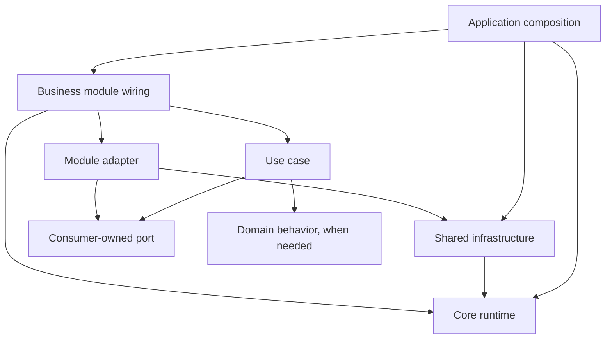

# Web Service Template

A modular backend application foundation with hexagonal-inspired business module conventions. Fastify serves HTTP, Awilix assembles the application and Prisma connects to PostgreSQL. For maintainers and coding agents, the engineering and review rules live in [AGENTS.md](AGENTS.md).

## 📋 Table of Contents

- [📝 Project Introduction](#-project-introduction)
- [🚀 Quick Start](#-quick-start)
- [📂 Project Structure](#-project-structure)
- [🏗 System Architecture](#-system-architecture)
- [💻 Development Guide](#-development-guide)
- [⚙️ Environment Variables](#-environment-variables)
- [🔧 Module Setup Example](#-module-setup-example)
- [📦 Deployment](#-deployment)
- [❓ FAQ](#-faq)

## 📝 Project Introduction

A fresh checkout starts a web server with a welcome page and an empty business-module registry. Add a business capability by declaring its dependencies in a module and including that module in the application. The [catalog example](#-module-setup-example) shows a complete request and the decision about whether an entry is visible.

## 🚀 Quick Start

Run the following commands from the repository root. Use the Node.js major in [.nvmrc](.nvmrc) and the pnpm version selected by [CI](.github/workflows/ci.yaml). If you use nvm, `nvm use` selects the project Node version.

1. In a fresh checkout, copy the local settings.

   ```bash
   cp .env.example .env
   ```

2. Set `DATABASE_URL` in your `.env` to a running local PostgreSQL database and confirm it accepts connections.

   The [development Compose file](.dev-app-projects/docker-compose.yaml) pairs `postgres:latest` with the data mount used by PostgreSQL 17 and earlier (`/var/lib/postgresql/data`). For a fresh database using the official PostgreSQL 18 or later image, mount a new data directory at `/var/lib/postgresql` in your local Compose configuration. See the [official image's volume guidance](https://github.com/docker-library/docs/blob/master/postgres/README.md#pgdata).

3. Install the dependencies and start the development server.

   ```bash
   pnpm run install:ci
   pnpm start
   ```

   `pnpm start` runs the build once. It generates Prisma Client, compiles TypeScript, then starts the TypeScript and nodemon watchers. A failed generation or compilation exits before either watcher starts. Save a TypeScript source file to rebuild and restart the server.

4. With the example settings, open `http://localhost:3000/` for the welcome page and `http://localhost:3000/docs` for Swagger UI. The UI is enabled in non-production environments.

## 📂 Project Structure

### Current checkout

The application builds as a single package. The following paths exist in the repository.

| Path | Responsibility |
| --- | --- |
| [index.ts](index.ts) | Composition root. Passes the global registrations and business modules to `setupApp`, registers the HTTP startup module and sequences startup and shutdown. |
| [src/modules/index.ts](src/modules/index.ts) | Exports the list of business module instances. It starts as an empty array. |
| [src/core/app](src/core/app) and [src/core/di](src/core/di) | Application lifecycle, container creation and dependency registration. |
| [src/core/server](src/core/server) | Fastify setup, route registration, HTTP errors and Swagger. |
| [src/core/config](src/core/config) and [src/core/services](src/core/services) | Environment loading and transformation, logging, and the current concrete Prisma configuration and client. |
| [src/core/types](src/core/types) and [src/core/utils](src/core/utils) | Module and startup contracts, registration helpers and initializer pool. |
| [prisma](prisma) | PostgreSQL schema, migrations and seed source. |
| [test-utils](test-utils) | Test containers, mocks and compile-time contract checks. |

TypeScript resolves `src/*` from the root and emits the application under `build/`. The [global DI registrations](src/core/di/global-di-configs.ts) currently select Prisma in Core.

### Target structure

The workspace design gives Core, each shared resource and each business module a package boundary. For example, the shared database client would live under `src/infrastructure/prisma/`. Module-local persistence code would stay beside the business capability that defines its port. In the workspace design, a module's implementation sits under its package's own `src/` and consumers use package exports. The workspace conversion, package build output and deployment work are tracked in the [workspace specification](https://github.com/RougeLi/WebServiceTemplate/issues/33).

## 🏗 System Architecture

This diagram shows the **target source dependencies**. Each arrow points from an importer to a dependency.



At runtime an HTTP request reaches the route, the controller converts the input and the use case calls the injected adapter through its port. An adapter backed by a database then calls the shared client. A compiled TypeScript interface adds no runtime call. A use case that only computes a result can call a pure domain function directly.

For new or explicitly refactored business flows, the source dependency is `Use Case → Port ← Adapter`. Use cases and domain code stay independent of concrete adapters, ORM types and HTTP transport types.

The stock application supports one active application per Node process. Its entry point explicitly registers `WebServerModule`. A business `IModule` declares dependencies, while an `IStartupModule` owns initialization, start and stop work. The precise boot order, initializer pool and current cleanup limits are documented in the [startup module guide](src/core/types/README.md).

## 💻 Development Guide

Run scripts from the repository root. Their definitions are in [package.json](package.json).

| Command | Purpose |
| --- | --- |
| `pnpm run install:ci` / `pnpm run install:dev` | Install with a frozen lockfile, or allow lockfile updates during development. |
| `pnpm run prisma:generate` | Generate the client used by the TypeScript sources. |
| `pnpm run build` / `pnpm start` | Generate Prisma Client and compile once, or build and start both development watchers. |
| `pnpm run lint` | Run source and spec type checks, Prettier checks and ESLint. |
| `pnpm run lint:fix` | Apply the configured formatting and ESLint fixes. |
| `pnpm run unittest` / `pnpm run unittest:coverage` | Run Jest with or without coverage reporting. |
| `pnpm run prisma:migrate` | Create and apply a development migration against the configured database. |
| `pnpm run prisma:reset` | Reset a disposable development database and reapply its migrations. This discards its data. |

## ⚙ Environment Variables

[`setupApp`](src/core/app/setup-app.ts) loads the local environment. [EnvironmentService](src/core/services/environment.service.ts) parses it with the [environment schema](src/core/config/environment.schema.ts) and exposes typed values through DI. Prisma reads its connection URL through the [Prisma schema](prisma/schema.prisma).

| Variable | Schema default when unset | Value in the example file |
| --- | --- | --- |
| `APP_NAME` | `ServiceTemplate` | `WebServiceTemplate` |
| `APP_ENV` | `production` | `development` |
| `PORT` | `3000` | `3000` |
| `DATABASE_URL` | Supply a PostgreSQL URL for database operations | Local development database |

See [.env.example](.env.example) for the local settings. When adding an application setting, update its schema, typed transform and relevant example together.

## 🔧 Module Setup Example

**Illustrative module.** The following file listings show how to add a catalog in the current single-package layout. The checkout ships with an empty registry. Each listing names its intended file. A client requests `GET /catalog/:id`. The use case returns only published entries, and the HTTP controller maps a missing or unpublished entry to 404.

| Location under `src/modules/catalog/` | Responsibility |
| --- | --- |
| `routes/`, `controllers/`, `dto/` | HTTP binding, access and schema, input/output mapping, and transport types. |
| `use-cases/find-published-entry/` | The visibility decision and the reader port consumed by this action. |
| `adapters/` | An implementation of the reader. This example uses in-memory records so it requires no new database table. |
| `domain/` or `constants/` | Optional. Introduce a named policy, value or constant when it has a responsibility of its own. |
| `catalog.module.ts`, `index.ts` | Bind dependencies and export the public module entry point. |

### Business decision and port

```typescript
// src/modules/catalog/use-cases/find-published-entry/entry-reader.port.ts
export interface CatalogEntry {
  readonly id: string;
  readonly title: string;
  readonly published: boolean;
}

export interface EntryReader {
  findById(id: string): Promise<CatalogEntry | undefined>;
}
```

```typescript
// src/modules/catalog/use-cases/find-published-entry/find-published-entry.use-case.ts
import type { EntryReader } from './entry-reader.port';

export class FindPublishedEntryUseCase {
  constructor(private readonly entryReader: EntryReader) {}

  async execute(id: string) {
    const entry = await this.entryReader.findById(id);
    if (entry?.published) {
      return { id: entry.id, title: entry.title };
    }
    return undefined;
  }
}
```

The port describes the operation in catalog terms. A PostgreSQL-backed adapter can implement the same contract and map its ORM record to `CatalogEntry`. A use case may consume several ports. A decision about transactions is needed when a required atomic update or consistency guarantee cannot be expressed by their existing contracts.

```typescript
// src/modules/catalog/adapters/in-memory-entry-reader.adapter.ts
import type {
  CatalogEntry,
  EntryReader,
} from '../use-cases/find-published-entry/entry-reader.port';

const entries: readonly CatalogEntry[] = [
  { id: 'guide', title: 'Field guide', published: true },
  { id: 'draft', title: 'Working draft', published: false },
];

export class InMemoryEntryReader implements EntryReader {
  async findById(id: string) {
    return entries.find((entry) => entry.id === id);
  }
}
```

### HTTP boundary

```typescript
// src/modules/catalog/dto/entry-params.dto.ts
import { type Static, Type } from '@sinclair/typebox';

export const entryParamsSchema = Type.Object({ id: Type.String() });
export type EntryParams = Static<typeof entryParamsSchema>;
```

```typescript
// src/modules/catalog/controllers/catalog.controller.ts
import { NotFoundError } from 'src/core/server';
import type { EntryReader } from '../use-cases/find-published-entry/entry-reader.port';
import { FindPublishedEntryUseCase } from '../use-cases/find-published-entry/find-published-entry.use-case';

export class CatalogController {
  private readonly findPublishedEntry: FindPublishedEntryUseCase;

  constructor(catalogEntryReader: EntryReader) {
    this.findPublishedEntry = new FindPublishedEntryUseCase(catalogEntryReader);
  }

  async find(id: string) {
    const entry = await this.findPublishedEntry.execute(id);
    if (entry === undefined) {
      throw new NotFoundError('Catalog entry not found');
    }
    return entry;
  }
}
```

```typescript
// src/modules/catalog/routes/catalog.route.ts
import type { WebServer } from 'src/core/types';
import { BaseRoute } from 'src/core/utils';
import type { CatalogController } from '../controllers/catalog.controller';
import { type EntryParams, entryParamsSchema } from '../dto/entry-params.dto';

export class CatalogRoute extends BaseRoute {
  constructor(private readonly catalogController: CatalogController) {
    super();
  }

  registerRoutes(server: WebServer): void {
    server.get<{ Params: EntryParams }>(
      '/catalog/:id',
      { schema: { params: entryParamsSchema } },
      (request) => this.catalogController.find(request.params.id),
    );
  }
}
```

### Module registration

The route registry resolves `catalogRoute`. Awilix `CLASSIC` injection uses constructor parameter names as tokens. The route receives `catalogController`, and the controller receives `catalogEntryReader`. The module selects one reader for all catalog requests. The controller is the sole consumer of the use case and constructs it directly with that reader. See the [DI and composition guidelines](AGENTS.md#di-與直接組裝).

```typescript
// src/modules/catalog/catalog.module.ts
import { BaseModule } from 'src/core/utils';
import { InMemoryEntryReader } from './adapters/in-memory-entry-reader.adapter';
import { CatalogController } from './controllers/catalog.controller';
import { CatalogRoute } from './routes/catalog.route';

export class CatalogModule extends BaseModule {
  registerDependencies(): void {
    this.registerSingletons([
      ['catalogEntryReader', InMemoryEntryReader],
      ['catalogController', CatalogController],
      ['catalogRoute', CatalogRoute],
    ]);
  }
}
```

```typescript
// src/modules/catalog/index.ts
export { CatalogModule } from './catalog.module';
```

```typescript
// src/modules/index.ts (registry after opting into the example)
import type { IModule } from 'src/core/types';
import { CatalogModule } from './catalog';

const modules: IModule[] = [new CatalogModule()];
export default modules;
```

With these illustrative files in place, `GET /catalog/guide` returns the published ID and title. Both `GET /catalog/draft` and an unknown ID return 404. Before adding the module, the stock welcome route remains available at `/`.

### Dependency Registration Helpers

Declare dependencies inside `registerDependencies()`. `registerDependency(token, classType)` defaults to singleton when its mode is omitted or `undefined`. `registerDependenciesByItems(items)` accepts readonly tuples of a token, class and optional mode. This allows mixed modes in one batch.

| Lifetime  | Single registration                   | Batch registration                  |
| --------- | ------------------------------------- | ----------------------------------- |
| Singleton | `registerSingleton(token, classType)` | `registerSingletons(items)`         |
| Scoped    | `registerScoped(token, classType)`    | `registerScopedDependencies(items)` |
| Transient | `registerTransient(token, classType)` | `registerTransients(items)`         |

All registration helpers return the current module, so calls can be chained.
Batch helpers accept readonly arrays and tuples, preserve input order, and
treat empty arrays as chainable no-ops.
Registering a class that extends `BaseRoute` through any helper also adds its
token to route registration automatically.

The `PROXY` and `CLASSIC` presets select injection style and retain the Awilix default transient lifetime. The current [registration factory](src/core/utils/di-registration-factory.ts) applies one preset per call. The [DI design discussion](https://github.com/RougeLi/WebServiceTemplate/issues/25) tracks how to model lifetime and injection style independently.

### Dependency Collection Lifecycle

Each `getRegisterDependencies()` call starts from empty state and runs
`registerDependencies()` again. Declare the same tokens, resolver modes, and
order on every call. Resolver objects may be recreated on each collection.

The returned collection and its registration tuples are readonly in TypeScript.
`BaseModule` keeps its collection private and returns a defensive array copy.
A failed collection propagates the original error and discards partial dependency registrations. A retry rebuilds the entire declaration. Runtime freezing and deep cloning of resolvers are outside this contract.

Route tokens remain in the existing process-wide `Set`. Rebuilding may register the same route token again, and the set deduplicates it. A failed collection leaves any already registered route tokens in the set. Repeated `setupApp()` calls create fresh containers, but the process-wide route registry is shared. The [module tests](src/core/utils/spec/base.module.spec.ts) and [application wiring tests](src/core/app/spec/setup-app.spec.ts) cover these behaviors.

## 📦 Deployment

Generate the Prisma client and build before packaging the runtime. Supply the compiled `build/` tree, runtime dependencies and generated client, and set the runtime environment for the deployment. In a POSIX shell, run the compiled HTTP entry point from the package root.

```bash
NODE_PATH=./build node build/index.js
```

Apply the project's migrations using `pnpm run prisma:deploy` as an authorized release step in an environment with the Prisma CLI. The local development watcher is `pnpm start`.

## ❓ FAQ

### How do I provide a cron job or worker?

Implement `IStartupModule` for your resource and register the instance in the composition root. The built-in startup module is `WebServerModule`. See the [startup extension points](src/core/types/README.md).

### Where do I put request validation and error handling?

Attach the transport schema to the route. Express a business outcome in the use case, then map it at the HTTP boundary. The [Fastify setup](src/core/server/bootstrap/web-server.ts) formats known HTTP errors and sends an internal error response for unrecognized failures.

### What if a technical component is already called a service or model?

Names such as `PrismaService`, an ORM model or a domain service can describe a real responsibility. In a new business module, start with the action, its dependencies and the actual transport or storage boundary. The [engineering guide](AGENTS.md) defines the conventions for implementation and review.
